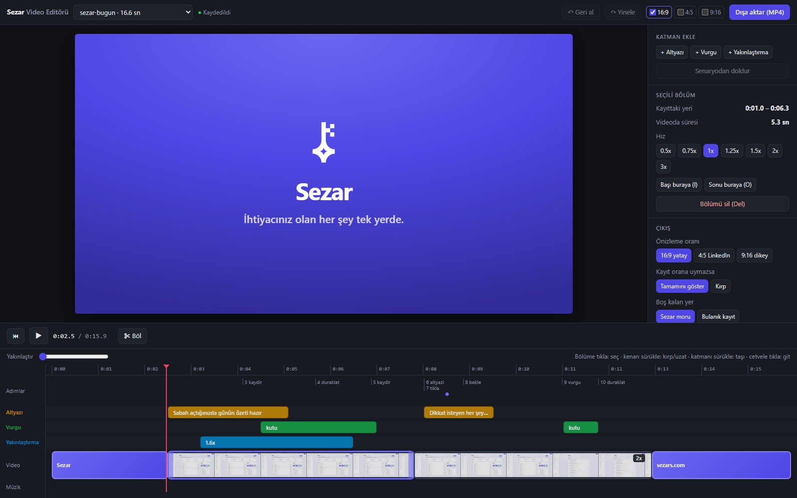
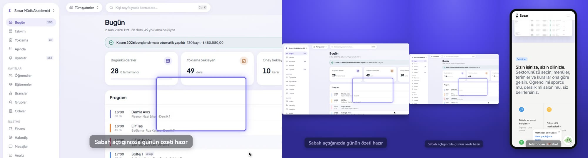
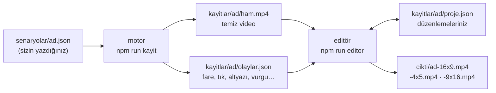
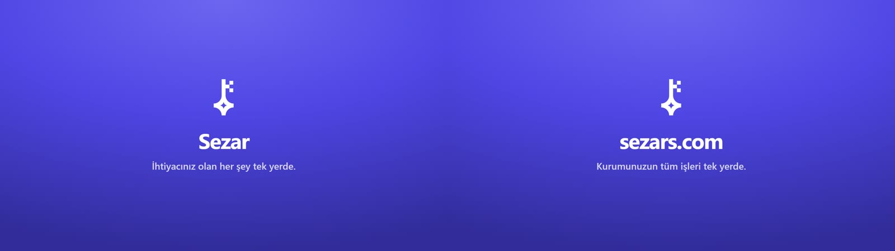

# Sezar Kayıt

**Yazdığınız senaryoya göre web uygulamanızı kendi kendine gezen, temiz bir ekran kaydı alan ve bunu tarayıcıdaki bir editörde altyazı, vurgu, yakınlaştırma, kart ve müzikle paylaşılabilir videoya çeviren araç.**

Yapay zekâ yok: aynı senaryo her çalıştırmada aynı kaydı üretir. Ürün değiştiğinde senaryoyu yeniden çalıştırırsınız, düzenlemeleriniz yerinde kalır.

*Scripted screen recordings for web apps: a JSON scenario drives Chrome, records a clean video plus an event log, and a local Remotion-based editor turns it into captioned, zoomed, branded MP4s in 16:9, 4:5 and 9:16. Turkish UI and docs.*



---

## İçindekiler

- [Ne yapar?](#ne-yapar)
- [Nasıl çalışır?](#nasıl-çalışır)
- [Kurulum](#kurulum)
- [Beş dakikada ilk video](#beş-dakikada-ilk-video)
- [1. Senaryo yazmak](#1-senaryo-yazmak)
- [2. Kaydetmek](#2-kaydetmek)
- [3. Editörde düzenlemek](#3-editörde-düzenlemek)
- [4. Dışa aktarmak](#4-dışa-aktarmak)
- [Kendi uygulamanızda kullanmak](#kendi-uygulamanızda-kullanmak)
- [Sezar demo sunucusu](#sezar-demo-sunucusu)
- [Klasörler](#klasörler)
- [Sorun giderme](#sorun-giderme)
- [Bilinen sınırlar](#bilinen-sınırlar)
- [Lisans ve bağımlılıklar](#lisans-ve-bağımlılıklar)

---

## Ne yapar?

**Kayıt**
- Tarayıcıyı JSON senaryoya göre sürer: sayfa açar, tıklar, harf harf yazar, kaydırır, bekler.
- Fare insan gibi hareket eder (hafif yay, yavaşlayıp hızlanma); rastgelelik tohumludur, her seferinde aynıdır.
- Video **temiz** kaydedilir: imleç, altyazı, vurgu videoya yakılmaz. Hepsi zaman damgalı bir olay günlüğüne yazılır ve editörde sonradan eklenir.
- Masaüstü (1920×1080), net masaüstü (3840×2160) ve telefon (390×844 mobil, 1170×2532 çıktı) görünümü.
- İsterseniz Chrome penceresini izleyerek, isterseniz arka planda.

**Editör** (tarayıcıda, `http://localhost:4600`)
- Kesme, bölme, kırpma, bölüm bölüm 0,5x–3x hız, geri al / yinele, otomatik kaydetme.
- İmleç ve tıklama halkası kayıttaki fare yolundan çizilir; boyutu ayarlanır, gizlenebilir.
- **Altyazı, vurgu, yakınlaştırma** katmanları: senaryodan kendiliğinden gelir, elle eklenir, zaman çizelgesinde sürüklenir.
- **Giriş ve kapanış kartı** (logo, başlık, alt satır, tema).
- **Müzik**: kendi dosyanız, ses düzeyi, başta açılma, sonda kısılma.
- **Üç oran tek seferde**: 16:9 (site, YouTube), 4:5 (LinkedIn akışı), 9:16 (dikey). Kayıt orana uymazsa tamamını gösterir ya da imleci izleyerek kırpar; telefon kayıtları telefon çerçevesinde.
- Önizleme ile dışa aktarma aynı bileşenden üretilir: ekranda gördüğünüz çıkar.



---

## Nasıl çalışır?



- **Motor** (`motor/`): Chrome'u `puppeteer-core` ile sürer. Kareler Chrome'dan zaman damgalı alınır (`Page.startScreencast`) ve ffmpeg ile 30 fps MP4'e birleştirilir; böylece video zamanı olay günlüğüyle birebir eşleşir.
- **Editör** (`editor/`): Vite + React arayüzü, önizleme için `@remotion/player`, dışa aktarma için `@remotion/renderer`. Ham video hiç değişmez; düzenlemeler `proje.json`'dadır.

---

## Kurulum

Gerekenler:

| Araç | Not |
|---|---|
| [Node.js](https://nodejs.org) 20 veya üstü | |
| [ffmpeg](https://ffmpeg.org) | `ffmpeg` komutu PATH'te olmalı (`ffmpeg -version` çalışmalı) |
| Google Chrome | Kayıt ve dışa aktarma bilgisayardaki Chrome'u kullanır; başka yoldaysa `CHROME_YOLU` ortam değişkeniyle verin |

```bash
git clone https://github.com/xkudcobi/sezar-kayit.git
cd sezar-kayit
npm install
```

Windows'ta geliştirildi ve denendi. Kayıt ve editör macOS/Linux'ta da çalışmalı; demo sunucusu yöneticisi (`motor/demo.mjs`) Windows'a özeldir.

---

## Beş dakikada ilk video

Depoda internet gerektirmeyen bir test sayfası ve senaryosu var.

**1. Kaydedin**
```bash
npm run kayit -- test-form
```
Çıktı: `kayitlar/test-form/ham.mp4` ve `olaylar.json`.

**2. Editörü açın**
```bash
npm run editor
```
Tarayıcıda `http://localhost:4600` açılır. Senaryodaki altyazı, vurgu ve yakınlaştırma zaten zaman çizelgesindedir.

**3. Dışa aktarın**
Sağ üstte oranları işaretleyip **Dışa aktar (MP4)**'e basın. Video `cikti/` klasörüne yazılır; bitince **Klasörde göster** çıkar.

---

## 1. Senaryo yazmak

Senaryo `senaryolar/<ad>.json` dosyasıdır:

```json
{
  "ad": "yeni-ogrenci",
  "gorunum": "masaustu",
  "adres": "http://localhost:3000",
  "gizle": [".bildirim-kutusu"],
  "hazirlik": [
    { "tur": "giris", "hesap": "demo" },
    { "tur": "git", "adres": "/ogrenciler", "bekle": "text=Yeni öğrenci" }
  ],
  "adimlar": [
    { "tur": "altyazi", "metin": "Yeni öğrenci eklemek birkaç saniye sürüyor", "sure": 3 },
    { "tur": "tikla", "oge": "text=Yeni öğrenci" },
    { "tur": "yaz", "oge": "input[name=ad]", "metin": "Ayşe Demir" },
    { "tur": "tikla", "oge": "text=Kaydet" },
    { "tur": "bekle", "ogeGorunene": "text=kaydedildi" },
    { "tur": "vurgu", "oge": "#sonuc", "sure": 1.5 },
    { "tur": "yakinlas", "oge": "#form", "oran": 1.5, "sure": 2 }
  ]
}
```

- `hazirlik`: kayda girmez (giriş, ilk sayfa yüklemesi). Video doğrudan hazır ekranla başlar.
- `adimlar`: videoya giren adımlar.
- Öğe yazımı: `text=Kaydet` (üzerindeki yazı), `tour=bugun` (`data-tour="bugun"`), ya da düz CSS seçici.

| Adım | Ne yapar |
|---|---|
| `git` | Sayfayı açar |
| `tikla` | Fareyi öğeye götürüp tıklar (ekranda değilse önce kaydırır) |
| `yaz` | Alana tıklayıp harf harf yazar |
| `tus` | Tuşa basar (`Enter`, `Escape`…) |
| `kaydir` | Yumuşak kaydırma (`piksel` ya da `oge`) |
| `uzerineGel` | Fareyi öğenin üstüne getirir |
| `bekle` | Öğe görünene / kaybolana, adres değişene kadar ya da `sure` kadar bekler |
| `duraklat` | Durur |
| `altyazi` · `vurgu` · `yakinlas` | Videoya bir şey çizmez; editörde katman olarak gelir |
| `giris` | `veri/hesaplar.json`'daki hesapla oturum açar |
| `fareyiGizle` | Editörde imleç bu noktadan sonra gizlenir |

Tüm alanlar, ipuçları ve örnekler: **[senaryolar/ADIMLAR.md](senaryolar/ADIMLAR.md)**.

Senaryo hatalıysa çalışmadan önce Türkçe ve adım numarasıyla söylenir:

```
✖ Senaryoda 2 hata var:
  - adım 1: bilinmeyen tür "tıkla". Geçerli türler: git, tikla, yaz, …
  - adım 2 (yaz): "metin" alanı eksik.
```

---

## 2. Kaydetmek

```bash
npm run kayit -- <senaryo>
```

| Bayrak | Ne yapar |
|---|---|
| `--izle` | Chrome penceresi açık kalır, kaydı izlersiniz (varsayılan: arka planda) |
| `--hiz=1.3` | Tüm hareket ve beklemeleri hızlandırır / yavaşlatır |
| `--sifirla` | Kayıttan önce demo verisini temiz yedekten geri yükler ([Sezar demo sunucusu](#sezar-demo-sunucusu)) |
| `--kareleri-tut` | Ham kareleri silmez (hata ayıklama) |

Çıktı `kayitlar/<ad>/`:
- `ham.mp4`: temiz kayıt
- `olaylar.json`: zaman damgalı olaylar (fare yolu, tıklar, yazılan metin, öğe kutuları, altyazı/vurgu/yakınlaştırma işaretleri)
- `senaryo.json`: kaydın hangi senaryodan çıktığı
- `hata.png`: bir adım takıldıysa o anın ekran görüntüsü (o ana kadarki video yine yazılır)

Arka plan modu daha akıcı kaydeder; `--izle` modunda pencere diğer pencerelerle yarıştığı için daha az kare yakalanabilir.

---

## 3. Editörde düzenlemek

```bash
npm run editor          # sunucuyu açar ve tarayıcıda gösterir
npm run editor:sessiz   # yalnız sunucu
```

Üstteki listeden kaydı seçin. Ekran dört bölümdür: **oynatıcı** (ortada), **sağ panel** (ayarlar), **taşıma çubuğu** ve **zaman çizelgesi** (altta).

### Zaman çizelgesi

| Satır | İçerik |
|---|---|
| Adımlar | Senaryo adımları ve tıklamalar (mor nokta) |
| Altyazı / Vurgu / Yakınlaştırma | Katman blokları: sürükleyip taşıyın, kenarından uzatın, seçip **Del** ile silin |
| Video | Küçük resimli bölümler; başta ve sonda kartlar |
| Müzik | Seçili müzik |

### Kesme ve hız

1. Oynatıcıyı yere getirin (cetvele tıklayın ya da ← →).
2. **S** ile bölün.
3. Bölüme tıklayın: sağ panelde hızını seçin (0,5x – 3x) ya da **Del** ile silin.
4. Kırpmak için bölümün kenarını sürükleyin ya da oynatıcıyı yere getirip **I** (başı buraya) / **O** (sonu buraya).

### Katmanlar

Yeni bir kayıt ilk açıldığında senaryodaki `altyazi`, `vurgu` ve `yakinlas` adımları **kendiliğinden** gelir. Sonradan senaryoyu değiştirip yeniden kaydederseniz **Senaryodan doldur** yalnız eksikleri ekler.

| Katman | Ekleme | Ayarlar |
|---|---|---|
| Altyazı | **+ Altyazı** | Metin; tüm altyazılar için koyu / açık / mor, altta / üstte, boyut |
| Vurgu | **+ Vurgu**, sonra oynatıcıda alanı sürükleyip çizin | Çerçeve ya da çevreyi karartma |
| Yakınlaştırma | **+ Yakınlaştırma**, sonra oynatıcıda merkeze tıklayın | 1,1x–3x, geçiş süresi, imleci izle |

Katmanlar kayıttaki ana bağlıdır: videoyu kesip hızlandırsanız da içeriğin üstünde kalır.

### Çıkış, kartlar, müzik

- **Çıkış**: önizleme oranı (16:9 / 4:5 / 9:16); kayıt orana uymazsa *Tamamını göster* (zemin Sezar moru ya da bulanık kayıt) veya *Kırp* (kadraj imleci izler ya da oynatıcıda seçilir); telefon kayıtlarında telefon çerçevesi.
- **Kartlar**: giriş ve kapanış kartı; başlık, alt satır, tema, logo, süre. Videoya yumuşak geçişle bağlanır.
- **Müzik**: *Müzik dosyası ekle…* (mp3, wav, m4a, aac, ogg; en çok 60 MB), ses düzeyi, başta açılma, sonda kısılma, başlangıç saniyesi. Müzik kısaysa başa dönerek çalar. **Telifli müzik kullanmayın.**



### Kısayollar

| Tuş | İş |
|---|---|
| Boşluk | Oynat / durdur |
| ← → | Bir kare (Shift ile 1 sn) |
| Home / End | Başa / sona |
| S | Böl |
| Del | Seçili bölümü ya da katmanı sil |
| I / O | Bölümün başını / sonunu buraya çek |
| Ctrl+Z / Ctrl+Y | Geri al / yinele |
| Esc | Oynatıcıda çizimden çık |

Düzenlemeler yarım saniye sonra kendiliğinden kaydedilir (sekme kapanırken de).

---

## 4. Dışa aktarmak

Üst çubukta istediğiniz oranları işaretleyip **Dışa aktar (MP4)**'e basın. Her oran sırayla üretilir:

```
cikti/<ad>-16x9-<tarih-saat>.mp4
cikti/<ad>-4x5-<tarih-saat>.mp4
cikti/<ad>-9x16-<tarih-saat>.mp4
```

H.264, 30 fps, müzik varsa AAC ses. Video kare kare üretildiği için önizleme takılsa bile çıktı akıcıdır. Geliştirme bilgisayarında 16 sn'lik bir video oran başına yaklaşık 1–1,5 dakika sürdü.

---

## Kendi uygulamanızda kullanmak

Motor herhangi bir web uygulamasıyla çalışır:

1. Senaryoda `adres`'i uygulamanızın adresi yapın (`http://localhost:3000` gibi).
2. Giriş gerekiyorsa ya `hazirlik` içinde `git` + `yaz` + `tikla` adımlarıyla girin, ya da `giris` adımını kendi giriş formunuza uyarlayın (`motor/adimlar.mjs` içindeki `giris`; Sezar'da `input[name="email"]`, `input[name="password"]`, `button[type="submit"]`).
3. Hesap bilgilerini `veri/hesaplar.json`'a yazın (git'e girmez; örnek: `veri/hesaplar.ornek.json`). **Yalnız test hesabı kullanın.**
4. Videoda görünmesini istemediğiniz bildirim, yardım balonu gibi öğeleri `gizle` alanına CSS seçicisi olarak ekleyin.
5. Gerçek kişi verisi içeren bir ortamda kayıt almayın; uydurma verili bir demo hesabı kullanın.

Kartlardaki logo ve renkler Sezar'ındır (`editor/ortak/Kompozisyon.tsx` › `SezarIsareti`, `KART_TEMASI`); kendi markanız için oradan değiştirin.

---

## Sezar demo sunucusu

Bu kısım Sezar'a özeldir; başka uygulamada gerekmez.

Videoların her seferinde aynı çıkması için Sezar ekranları ayrı bir demo sunucusunda çekilir:

- Sezar kodunun ayrı bir kopyası (git worktree) ayrı bir portta (3005) çalışır; geliştirme sunucusuna ve veritabanına dokunulmaz.
- Veri, her sıfırlamada uydurma bir demo kurumun temiz yedeğinden kopyalanır.
- Sunucunun ve sayfanın saati sabitlenir (`veri/saat.cjs`); "bugün" her kayıtta aynı gündür.
- Demo sunucusu e-posta ayarı olmadan çalışır, gerçek e-posta göndermez.

```bash
npm run demo -- sifirla    # veriyi temizle + sunucuyu aç
npm run demo -- kapat
npm run demo -- durum
npm run kayit -- sezar-bugun --sifirla
```

Ayarlar `veri/demo.json` dosyasındadır (yollar geliştirme bilgisayarına göredir). Ayrıntılar: [senaryolar/ADIMLAR.md › Sezar demo sunucusu](senaryolar/ADIMLAR.md#sezar-demo-sunucusu).

---

## Klasörler

```
motor/          kayıt motoru (calistir, adimlar, kaydedici, fare, senaryo, demo)
editor/         düzenleme ekranı
  sunucu.mjs    yerel sunucu: arayüz, video, proje kaydı, müzik, dışa aktarma
  ortak/        önizleme ve dışa aktarmanın ortak kodu (Kompozisyon.tsx, proje.ts)
  remotion/     dışa aktarma girişi
  src/          arayüz (App.tsx, ZamanCizelgesi.tsx)
senaryolar/     senaryolar ve ADIMLAR.md rehberi
veri/           test sayfası, sabit saat, demo ve hesap ayarları
belgeler/       README görselleri
kayitlar/       kayıtlar (git'e girmez)
cikti/          dışa aktarılan videolar (git'e girmez)
muzik/          müzik dosyalarınız (git'e girmez)
```

---

## Sorun giderme

| Belirti | Çözüm |
|---|---|
| `Chrome bulunamadı` | `CHROME_YOLU` ortam değişkenine chrome.exe yolunu verin |
| `ffmpeg video üretemedi` | `ffmpeg -version` çalışıyor mu bakın; PATH'e ekleyin |
| `"…" öğesi 15 sn içinde sayfada görünmedi` | Seçici yanlış ya da sayfa yavaş. `hata.png`'ye bakın; `zamanAsimi` (ms) artırın; ilk açılışta derlenen sayfaları `hazirlik`'te bir kez açın |
| Dışa aktarmada `No frame found at position` | Eski (B-kareli) kayıtlarda arada olabilir; editör tek işçiyle kendiliğinden yeniden dener. Kalıcıysa kaydı yeniden alın (yeni kayıtlar B-karesizdir) |
| Önizleme takılıyor | Bilgisayara göre olabilir; dışa aktarılan video kare kare üretilir ve akıcıdır |
| Port dolu | `EDITOR_PORT=4700 npm run editor` |

---

## Bilinen sınırlar

- Telefon çerçevesi açıkken alttaki altyazı telefonun alt kenarına binebilir; altyazıyı **Üstte** seçin.
- Zaman çizelgesinde müzik sürüklenemez; başlangıcı sağ panelden ayarlanır.
- Demo sunucusu yöneticisi Windows'a ve Sezar'ın yapısına göre yazıldı.

---

## Lisans ve bağımlılıklar

- Bu depoya henüz bir açık kaynak lisansı eklenmedi; kodu kullanmak ya da dağıtmak isterseniz önce iletişime geçin.
- Editör [Remotion](https://www.remotion.dev) kullanır. Remotion bireyler ve en çok 3 çalışanlı şirketler için ücretsizdir; daha büyük ekipler için [şirket lisansı](https://www.remotion.dev/license) gerekir.
- Diğer bağımlılıklar: [puppeteer-core](https://github.com/puppeteer/puppeteer) (Apache-2.0), [Vite](https://vitejs.dev) (MIT), [React](https://react.dev) (MIT), ffmpeg (sistemde kurulu).
